# Taller: Sistema web seguro como control de riesgos empresariales

**URL desplegada:** https://tallerriesgos.duckdns.org

**Autor:** Juan Esteban Lozano

---

## 1. Objetivo

Construir e implementar un sistema web pequeño compuesto por:

- Un frontend en **React** (Vite).
- Autenticación de usuarios con **Auth0**.
- Un backend mínimo en **Spring Boot** protegido como **servidor de recursos OAuth 2.0**.
- Una dirección **HTTPS pública** usando **Duck DNS**, **Apache HTTP Server** y un certificado **Let's Encrypt**.

El backend expone un único endpoint protegido (`/api/risk-status`). El frontend autentica al usuario con Auth0, obtiene un token de acceso (JWT) y lo envía en el encabezado `Authorization: Bearer <token>`.

---

## 2. Arquitectura

```
Navegador
  │ login y access token
  ▼
Auth0 ───────────────► Frontend React ── Bearer token ──► API Spring Boot
                                                        │
Internet ── Duck DNS ── Apache + TLS ──────────────────┘
```

Flujo en producción:

1. El usuario entra a `https://tallerriesgos.duckdns.org`.
2. Duck DNS resuelve el dominio a la IP pública del servidor en AWS EC2.
3. Apache atiende en el puerto 443 con el certificado de Let's Encrypt y entrega el frontend React.
4. El usuario inicia sesión en Auth0 y recibe un access token con audiencia `https://enterprise-risk-api`.
5. El frontend llama a `/api/risk-status`. Apache reenvía la petición internamente a Spring Boot en `127.0.0.1:8080`.
6. Spring Boot valida la firma, el emisor (issuer) y la audiencia del JWT antes de responder.

---

## 3. Tecnologías utilizadas

| Componente | Tecnología |
|---|---|
| Frontend | React + Vite + @auth0/auth0-react |
| Backend | Java 21, Spring Boot 4, Spring Security, OAuth2 Resource Server, Actuator |
| Identidad | Auth0 (SPA + API, algoritmo RS256) |
| Servidor | AWS EC2, Ubuntu Server 24.04 LTS |
| DNS | Duck DNS (`tallerriesgos.duckdns.org`) |
| Servidor web / proxy | Apache HTTP Server 2.4 |
| Certificado TLS | Let's Encrypt (Certbot) |
| Equipo de desarrollo | Windows (PowerShell / CMD) |

---

## 4. Estructura del repositorio

```
taller-riesgos/
├── backend/          Código fuente Spring Boot
├── frontend/         Código fuente React
├── docs/             Capturas de evidencia
├── README.md
└── .gitignore
```

---

## 5. Paso a paso de la implementación

### Parte 1. Configuración de Auth0

**1.1 Creación del tenant.** Se creó un tenant en Auth0, con dominio de la forma `TENANT.us.auth0.com`.

**1.2 Creación de la API.** En *Applications → APIs* se creó la API:

- Nombre: `Enterprise Risk Lab API`
- Identificador (audiencia): `https://enterprise-risk-api`
- Algoritmo de firma: `RS256`

**1.3 Definición del permiso.** En la pestaña *Permissions* de la API se agregó:

| Permiso | Descripción |
|---|---|
| `read:risk` | Lea el estado de riesgo protegido |

**1.4 Creación de la aplicación SPA.** En *Applications → Applications* se creó una aplicación de tipo *Single Page Application* llamada `Enterprise Risk Lab Frontend`, con estos valores:

- Allowed Callback URLs: `http://localhost:5173,https://tallerriesgos.duckdns.org`
- Allowed Logout URLs: `http://localhost:5173,https://tallerriesgos.duckdns.org`
- Allowed Web Origins: `http://localhost:5173,https://tallerriesgos.duckdns.org`

No se usaron comodines.

**1.5 Acceso delegado del usuario.** En la pestaña *APIs* de la SPA se editó `Enterprise Risk Lab API` y, en *User Delegated Access*, se otorgó el permiso `read:risk`. Esto permite que la SPA solicite tokens en nombre del usuario que inicia sesión. El "Client Access" no se usó, porque es para aplicaciones máquina a máquina.

**1.6 Datos de configuración del cliente.** Se registraron el dominio, el Client ID y la audiencia. El Client Secret **no** se usa en el frontend, porque una aplicación de navegador no puede guardar secretos.

**1.7 Usuario de prueba.** En *User Management → Users → Create User → Create via UI* se creó un usuario con la conexión `Username-Password-Authentication`.

---

### Parte 2. Backend Spring Boot

**2.1 Generación del proyecto.** Se generó en https://start.spring.io con:

- Maven, Java 21, Group `com.taller`, Artifact `backend`.
- Dependencias: Spring Web, Spring Security, OAuth2 Resource Server y Spring Boot Actuator. Actuator se agregó para que exista el endpoint `/actuator/health`.

**2.2 Clase principal** (`BackendApplication.java`):

```java
package com.taller.backend;

import org.springframework.boot.SpringApplication;
import org.springframework.boot.autoconfigure.SpringBootApplication;

@SpringBootApplication
public class BackendApplication {
  public static void main(String[] args) {
    SpringApplication.run(BackendApplication.class, args);
  }
}
```

**2.3 Configuración de seguridad** (`SecurityConfig.java`):

- `/actuator/health` es público.
- `/api/**` requiere un JWT válido.
- Cualquier otra ruta se rechaza (`denyAll`).
- CORS se restringe a `http://localhost:5173` y `https://tallerriesgos.duckdns.org`, solo método GET.

```java
@Configuration
@EnableWebSecurity
public class SecurityConfig {

  @Bean
  SecurityFilterChain securityFilterChain(HttpSecurity http) throws Exception {
    return http
        .csrf(csrf -> csrf.disable())
        .cors(Customizer.withDefaults())
        .authorizeHttpRequests(auth -> auth
            .requestMatchers("/actuator/health").permitAll()
            .requestMatchers("/api/**").authenticated()
            .anyRequest().denyAll())
        .oauth2ResourceServer(oauth2 -> oauth2.jwt(Customizer.withDefaults()))
        .build();
  }

  @Bean
  CorsConfigurationSource corsConfigurationSource() {
    CorsConfiguration config = new CorsConfiguration();
    config.setAllowedOrigins(List.of(
        "http://localhost:5173",
        "https://tallerriesgos.duckdns.org"));
    config.setAllowedMethods(List.of("GET"));
    config.setAllowedHeaders(List.of("Authorization", "Content-Type"));
    UrlBasedCorsConfigurationSource source = new UrlBasedCorsConfigurationSource();
    source.registerCorsConfiguration("/**", config);
    return source;
  }
}
```

**2.4 Endpoint protegido** (`RiskController.java`):

```java
@RestController
@RequestMapping("/api")
public class RiskController {

  @GetMapping("/risk-status")
  public Map<String, Object> riskStatus(@AuthenticationPrincipal Jwt jwt) {
    return Map.of(
        "status", "protected",
        "subject", jwt.getSubject(),
        "control", "JWT validation and authenticated access");
  }
}
```

**2.5 Configuración del servidor de recursos** (`application.properties`):

```
spring.security.oauth2.resourceserver.jwt.issuer-uri=https://TENANT.us.auth0.com/
spring.security.oauth2.resourceserver.jwt.audiences=https://enterprise-risk-api
server.port=8080
```

El `issuer-uri` lleva `https://` y barra final; la audiencia coincide exactamente con el identificador de la API en Auth0.

**2.6 Prueba local.** Se ejecutó con `./mvnw spring-boot:run` y se verificó desde PowerShell:

```
curl.exe -i http://localhost:8080/actuator/health     → 200 {"status":"UP"}
curl.exe -i http://localhost:8080/api/risk-status     → 401 Unauthorized
```

El 401 confirma que la API rechaza las peticiones sin token.

---

### Parte 3. Frontend React

**3.1 Creación del proyecto:**

```
npm create vite@latest frontend -- --template react
cd frontend
npm install
npm add @auth0/auth0-react
```

**3.2 Variables de entorno** (`.env.local`, no se sube al repositorio):

```
VITE_AUTH0_DOMAIN=TENANT.us.auth0.com
VITE_AUTH0_CLIENT_ID=CLIENT_ID
VITE_AUTH0_AUDIENCE=https://enterprise-risk-api
VITE_API_URL=http://localhost:8080
```

**3.3 `src/main.jsx`.** La aplicación se envolvió en `Auth0Provider`, con `redirect_uri` igual a `window.location.origin` y `audience` igual a la de la API.

**3.4 `src/App.jsx`.** Es un cliente mínimo con botones de *Log in*, *Call protected API* y *Log out*. Obtiene el token con `getAccessTokenSilently()` y lo envía en el encabezado `Authorization: Bearer`. Si la API responde con error, muestra el código HTTP real.

**3.5 Prueba local.** Con `npm run dev` se abrió `http://localhost:5173`, se inició sesión con el usuario de prueba y se llamó a la API, que devolvió el JSON protegido.

---

### Parte 4. Servidor y Duck DNS

**4.1 Servidor.** Se creó una instancia **AWS EC2** con **Ubuntu Server 24.04 LTS** (t2/t3.micro) y un par de llaves `.pem`.

**4.2 Reglas de red (Security Group):**

| Puerto | Origen | Uso |
|---|---|---|
| 22 (SSH) | Solo la IP del administrador | Administración |
| 80 (HTTP) | 0.0.0.0/0 | Validación de Let's Encrypt y redirección a HTTPS |
| 443 (HTTPS) | 0.0.0.0/0 | Aplicación |
| 8080 | **No expuesto** | Solo uso interno |

**4.3 Llave SSH en Windows.** Como `chmod` no existe en Windows, los permisos de la llave se restringieron con `icacls`:

```
icacls "$env:USERPROFILE\.ssh\LLAVE.pem" /inheritance:r
icacls "$env:USERPROFILE\.ssh\LLAVE.pem" /grant:r "$($env:USERNAME):(R)"
```

La conexión se hizo con la IP **pública** de la instancia (no la privada `172.31.x.x`):

```
ssh -i "$env:USERPROFILE\.ssh\LLAVE.pem" ubuntu@IP_PUBLICA
```

**4.4 Endurecimiento básico del servidor:**

```
sudo apt update && sudo apt upgrade -y
sudo adduser deploy
sudo usermod -aG sudo deploy
sudo ufw allow OpenSSH
sudo ufw allow 80/tcp
sudo ufw allow 443/tcp
sudo ufw enable
```

**4.5 Duck DNS.** Se creó el subdominio `tallerriesgos.duckdns.org`, apuntando a la IP pública del servidor. Para mantener la IP actualizada se creó el script `~/duckdns/duck.sh`, que llama a la API de Duck DNS (dejando `ip=` vacío para que detecte la IP automáticamente), y se programó en `crontab` cada 5 minutos:

```
*/5 * * * * ~/duckdns/duck.sh >/dev/null 2>&1
```

El script respondió `OK`. La resolución se verificó comparando la IP pública del servidor con la del dominio:

```
curl -s ifconfig.me             → 54.197.131.62
getent hosts tallerriesgos.duckdns.org → 54.197.131.62
```

El token de Duck DNS no se incluye en el repositorio.

**4.6 Paquetes instalados:**

```
sudo apt install -y apache2 certbot python3-certbot-apache openjdk-21-jre
```

**4.7 Compilación en el equipo de desarrollo (Windows).**

Frontend: se creó `.env.production` con `VITE_API_URL=https://tallerriesgos.duckdns.org` y se compiló con `npm run build`, renombrando temporalmente `.env.local` para que no tuviera prioridad.

Backend:

```
./mvnw clean package
```

Esto generó `target/backend-0.0.1-SNAPSHOT.jar`.

**4.8 Transferencia segura al servidor (scp sobre SSH):**

```
scp -i "%USERPROFILE%\.ssh\LLAVE.pem" -r frontend\dist ubuntu@IP_PUBLICA:/home/ubuntu/
scp -i "%USERPROFILE%\.ssh\LLAVE.pem" backend\target\backend-0.0.1-SNAPSHOT.jar ubuntu@IP_PUBLICA:/home/ubuntu/app.jar
```

---

### Parte 5. Despliegue del backend como servicio

**5.1 Directorio y usuario del servicio** (mínimo privilegio):

```
sudo mkdir -p /opt/enterprise-risk-api
sudo cp /home/ubuntu/app.jar /opt/enterprise-risk-api/app.jar
sudo useradd --system --no-create-home riskapi
sudo chown -R riskapi:riskapi /opt/enterprise-risk-api
```

**5.2 Servicio systemd** (`/etc/systemd/system/enterprise-risk-api.service`):

```ini
[Unit]
Description=Enterprise Risk API
After=network.target

[Service]
User=riskapi
WorkingDirectory=/opt/enterprise-risk-api
Environment="SPRING_SECURITY_OAUTH2_RESOURCESERVER_JWT_ISSUER_URI=https://TENANT.us.auth0.com/"
Environment="SPRING_SECURITY_OAUTH2_RESOURCESERVER_JWT_AUDIENCES=https://enterprise-risk-api"
Environment="SERVER_ADDRESS=127.0.0.1"
ExecStart=/usr/bin/java -jar /opt/enterprise-risk-api/app.jar
Restart=always

[Install]
WantedBy=multi-user.target
```

Se agregó `SERVER_ADDRESS=127.0.0.1` para que Spring Boot escuche solo localmente. Así el puerto 8080 queda inaccesible desde Internet aunque falle el firewall (defensa en profundidad).

**5.3 Arranque y verificación:**

```
sudo systemctl daemon-reload
sudo systemctl enable --now enterprise-risk-api
sudo systemctl status enterprise-risk-api      → active (running)
curl http://127.0.0.1:8080/actuator/health     → {"status":"UP"}
sudo ss -tlnp | grep 8080                      → 127.0.0.1:8080
```

---

### Parte 6. Apache y HTTPS

**6.1 Publicación del frontend:**

```
sudo mkdir -p /var/www/enterprise-risk-frontend
sudo cp -r /home/ubuntu/dist/* /var/www/enterprise-risk-frontend/
```

**6.2 Módulos de Apache:**

```
sudo a2enmod ssl proxy proxy_http rewrite headers
```

**6.3 Virtual host** (`/etc/apache2/sites-available/enterprise-risk.conf`):

```apache
<VirtualHost *:80>
    ServerName tallerriesgos.duckdns.org
    DocumentRoot /var/www/enterprise-risk-frontend

    <Directory /var/www/enterprise-risk-frontend>
        Options -Indexes
        AllowOverride None
        Require all granted
        RewriteEngine On
        RewriteCond %{REQUEST_FILENAME} !-f
        RewriteCond %{REQUEST_FILENAME} !-d
        RewriteRule ^ /index.html [L]
    </Directory>

    ProxyPreserveHost On
    ProxyPass /api/ http://127.0.0.1:8080/api/
    ProxyPassReverse /api/ http://127.0.0.1:8080/api/
    RequestHeader set X-Forwarded-Proto "http"
</VirtualHost>
```

Apache sirve el frontend y reenvía `/api/` a Spring Boot. La regla de reescritura permite que funcionen las rutas de la SPA.

**6.4 Activación del sitio:**

```
sudo a2dissite 000-default.conf
sudo a2ensite enterprise-risk.conf
sudo apachectl configtest      → Syntax OK
sudo systemctl reload apache2
```

**6.5 Certificado Let's Encrypt:**

```
sudo certbot --apache -d tallerriesgos.duckdns.org
```

Resultado: certificado emitido y desplegado, válido hasta el 12 de enero de 2027. Certbot creó el virtual host `enterprise-risk-le-ssl.conf` en el puerto 443 y añadió la redirección automática de HTTP a HTTPS. En el virtual host del 443 se cambió el encabezado a `X-Forwarded-Proto "https"`.

**6.6 Prueba de renovación:**

```
sudo certbot renew --dry-run   → all simulated renewals succeeded
```

---

### Parte 7. Lista de verificación

| Verificación | Comando / evidencia | Resultado |
|---|---|---|
| Solicitudes sin token devuelven 401 | `curl.exe -i https://tallerriesgos.duckdns.org/api/risk-status` | 401 ✅ |
| Usuario autenticado llama a `/api/risk-status` | Captura del navegador | JSON `"status":"protected"` ✅ |
| El backend valida emisor y audiencia del JWT | `issuer-uri` y `audiences` en el servicio | ✅ |
| App disponible por HTTPS | https://tallerriesgos.duckdns.org | ✅ |
| Certificado válido con candado | Detalles del certificado / `sudo certbot certificates` | Let's Encrypt ✅ |
| Puerto 8080 inaccesible desde Internet | `Test-NetConnection tallerriesgos.duckdns.org -Port 8080` | TcpTestSucceeded: False ✅ |
| Renovación funciona | `sudo certbot renew --dry-run` | ✅ |

---

## 6. Autenticación vs. autorización

- **Autenticación:** verificar *quién* es el usuario. En este sistema la realiza Auth0 cuando el usuario inicia sesión con su correo y contraseña.
- **Autorización:** decidir *qué puede hacer* esa identidad. La API solo permite el acceso si recibe un JWT válido, firmado por Auth0 (RS256), emitido por el tenant correcto (issuer) y dirigido a ella (audiencia `https://enterprise-risk-api`). La SPA además debe tener acceso delegado al permiso `read:risk`.

---

## 7. Reflexión sobre control de riesgos

| Control | Riesgo reducido | Evidencia |
|---|---|---|
| Autenticación Auth0 | Suplantación de identidad y manejo deficiente de credenciales | Flujo de inicio de sesión de Auth0 e identidad del usuario |
| Validación de JWT en la API | Acceso no autorizado a la API | 401 sin un token válido |
| Validación de audiencia | Reutilización de tokens contra otra API | La API solo acepta `https://enterprise-risk-api` |
| HTTPS con certificado válido | Exposición de credenciales o tokens en tránsito | Detalles del certificado en el navegador |
| Proxy inverso Apache | Exposición directa del puerto de la aplicación | Solo los puertos 80 y 443 son públicos; 8080 escucha en 127.0.0.1 |
| Registros del servicio (journald) | Investigación tardía de incidentes | `journalctl -u enterprise-risk-api` |
| Usuario de servicio `riskapi` sin login | Escalamiento de privilegios si la app es comprometida | Servicio ejecutado como `riskapi` |
| Firewall UFW + Security Group | Exposición de servicios innecesarios | Solo 22 (restringido), 80 y 443 |

---

## 8. Notas de seguridad

- No se suben al repositorio `.env.local`, `.env.production`, llaves `.pem`, secretos de Auth0 ni el token de Duck DNS (ver `.gitignore`).
- La SPA usa solo el Client ID de Auth0, nunca un Client Secret.
- CORS está restringido a los orígenes exactos de desarrollo y producción.
- Los tokens de acceso se tratan como datos confidenciales: no se muestran, registran ni almacenan manualmente.
- El servidor aplica mínimo privilegio y debe recibir actualizaciones periódicas (`sudo apt update && sudo apt upgrade`).

---

## 9. Ejecución local

**Backend:**

```
cd backend
./mvnw spring-boot:run
```

**Frontend** (requiere crear `.env.local` con los valores de Auth0):

```
cd frontend
npm install
npm run dev
```

Luego abrir http://localhost:5173.

---

## 10. Evidencias
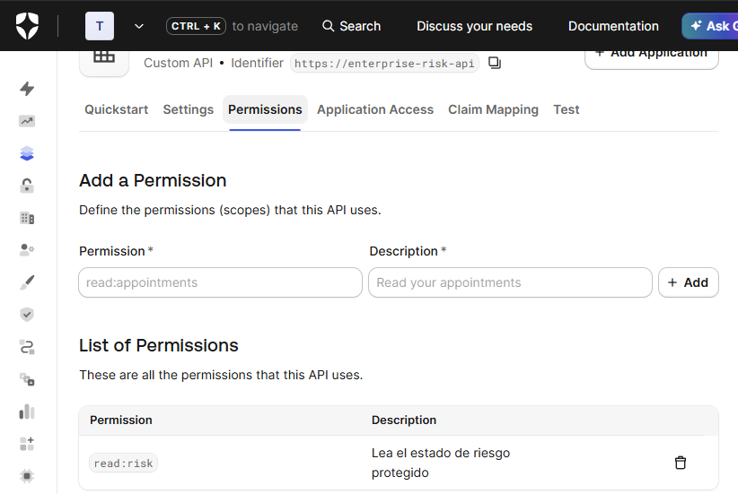
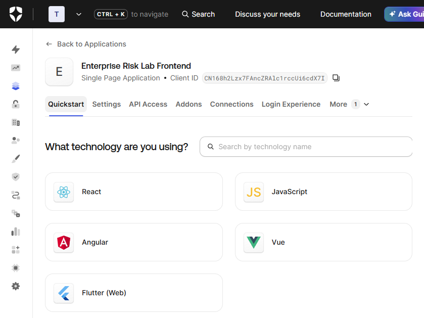
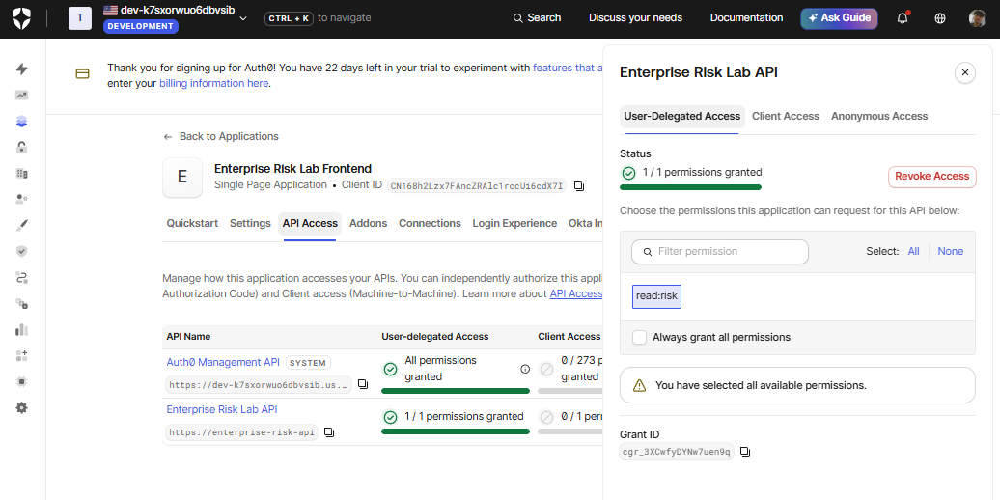
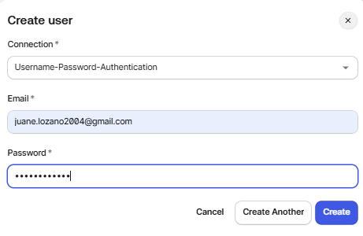
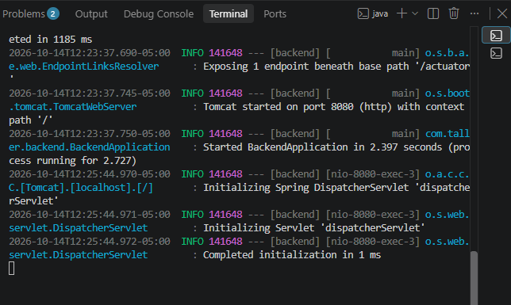
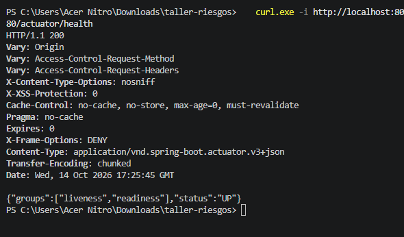
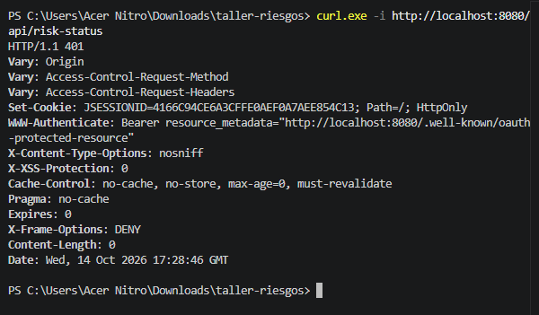
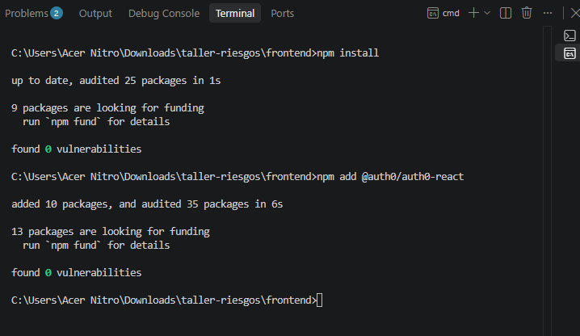
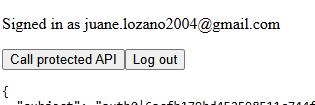
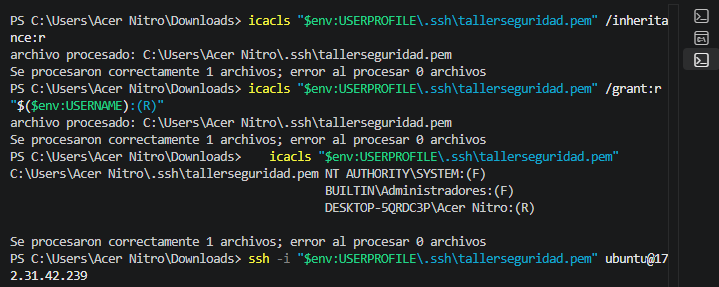
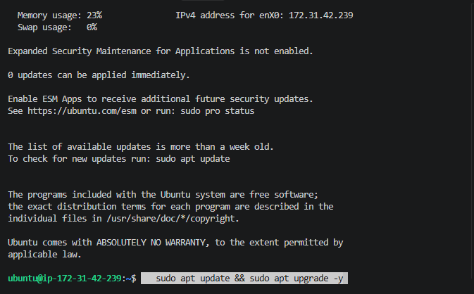
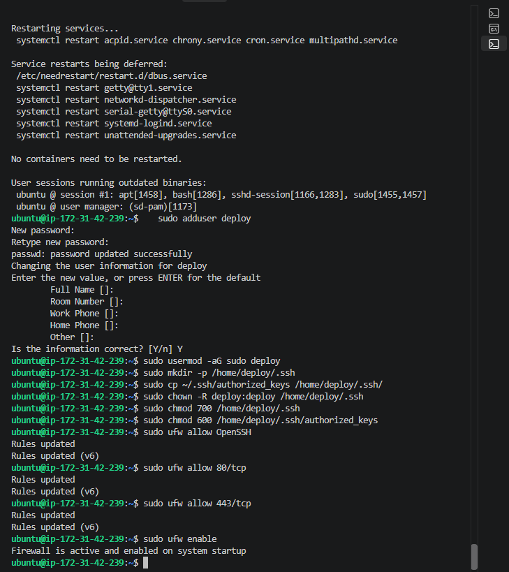
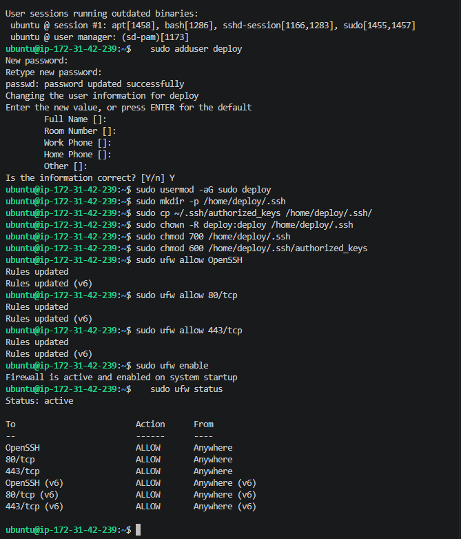
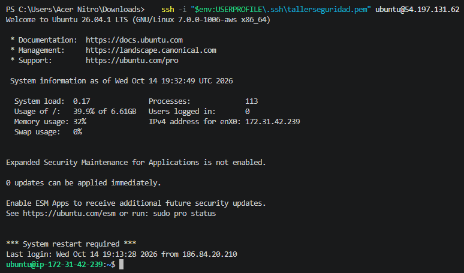
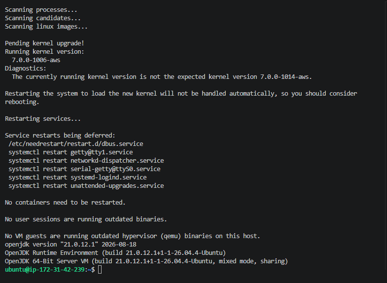
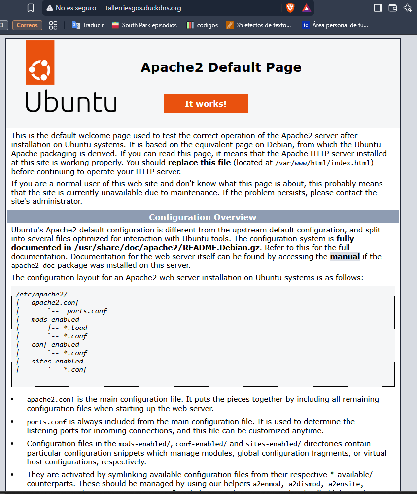
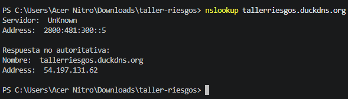
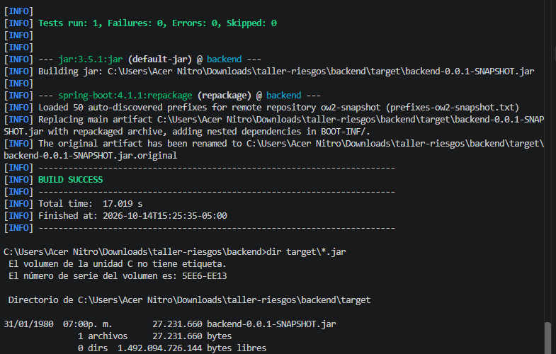
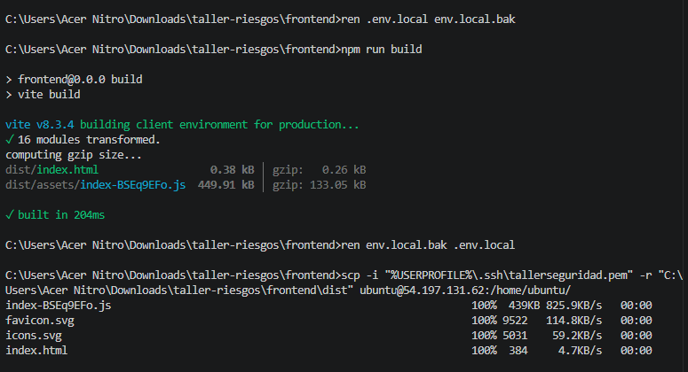
